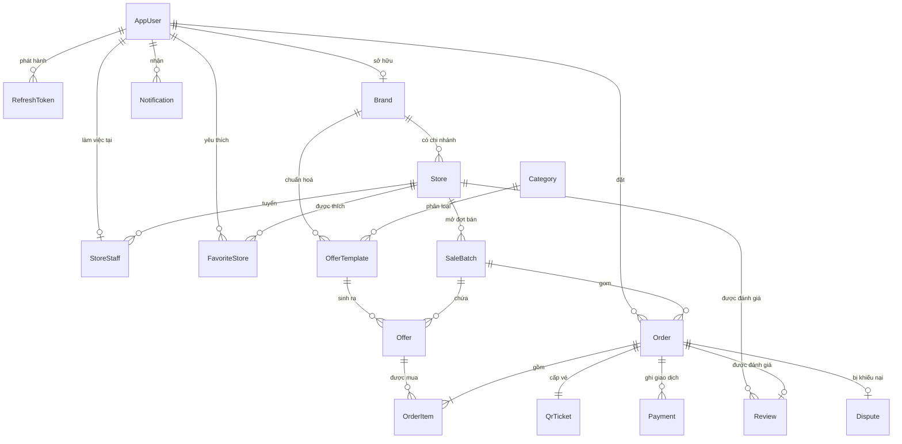

# FreshRescue — Mô hình dữ liệu (ERD)

> Yêu cầu: `01-REQUIREMENTS.md` · Kế hoạch: `00-PLAN.md`
> Cập nhật: 2026-09-28 — bỏ bảng `DeviceToken` (không còn app di động, `00-PLAN.md` §0)
>
> **17 bảng nghiệp vụ** + các bảng hạ tầng của ASP.NET Core Identity.
> Mọi mã `BR-xx` / `FR-xx` tham chiếu tới `01-REQUIREMENTS.md`.

---

## 1. Bảy nguyên tắc thiết kế

Đọc trước khi xem bảng — mỗi quyết định dưới đây lặp lại ở nhiều chỗ.

| # | Nguyên tắc | Lý do |
| --- | --- | --- |
| 1 | **Khoá chính `Guid`**, **sinh ở tầng ứng dụng bằng `Guid.NewGuid()`** | Tránh lộ số lượng đơn hàng qua id tuần tự (id nằm trên URL và trong token QR). Id có sẵn ngay khi `new` entity, không phải chờ `SaveChangesAsync`. *Lý do ban đầu — app di động cần sinh id khi offline — đã hết hiệu lực 28/09; vẫn giữ `Guid` vì đổi kiểu khoá bây giờ không đem lại gì. Đánh đổi: chỉ mục bị phân mảnh hơn, chấp nhận được ở quy mô đồ án* |
| 2 | **Mọi thời gian lưu UTC** (`datetime2`) | `OQ-33`. Không có cột nào lưu giờ Việt Nam |
| 3 | **Tiền `decimal(18,0)`** | `OQ-20`. VND không có phần lẻ. Không bao giờ dùng `float` cho tiền |
| 4 | **Toạ độ `decimal(9,6)`** | Đủ độ chính xác ~11cm, nhẹ hơn kiểu `geography` và đủ cho Haversine |
| 5 | **Xoá mềm** qua `ISoftDelete` + Global Query Filter | `OQ-06`, `BR-22` |
| 6 | **`RowVersion` chỉ ở `Offer` và `Order`** | Đây là hai bảng duy nhất có tranh chấp ghi đồng thời. Rải khắp nơi chỉ làm chậm |
| 7 | **Chụp ảnh dữ liệu (snapshot) tại thời điểm giao dịch** | `BR-18`. Giá và tên phải đóng băng trong đơn hàng, không đi theo bản gốc |

### 1.1. Các interface dùng chung

```csharp
public interface IAuditable   { DateTime CreatedAt { get; set; }
                                DateTime? UpdatedAt { get; set; } }

public interface ISoftDelete  { bool IsDeleted { get; set; }
                                DateTime? DeletedAt { get; set; } }
```

Áp `ISoftDelete` cho: `Brand`, `Store`, `Category`, `OfferTemplate`, `Offer`.
Áp `IAuditable` cho hầu hết bảng nghiệp vụ. Cài đặt tập trung trong
`SaveChangesAsync()` override — **không** để mỗi service tự gán tay.

---

## 2. Sơ đồ quan hệ



**Đọc sơ đồ:** trục chính chạy từ trên xuống —
`Brand → Store → SaleBatch → Offer → OrderItem → Order`.
Mọi thứ còn lại là nhánh phụ.

---

## 3. Chi tiết các bảng

Ký hiệu: 🔑 khoá chính · 🔗 khoá ngoại · ⭐ unique · 📇 có chỉ mục

### 3.1. Danh tính & phiên đăng nhập

#### `AppUser : IdentityUser<Guid>`

| Cột | Kiểu | Ghi chú |
| --- | --- | --- |
| Id 🔑 | `Guid` | Của Identity |
| *(Email, PasswordHash, PhoneNumber…)* | | Của Identity |
| FullName | `nvarchar(100)` | |
| AvatarUrl | `nvarchar(500)` | Đường dẫn tương đối (`OQ-09`) |
| IsActive | `bit` | Admin khoá tài khoản |
| CreatedAt | `datetime2` | |

4 role cố định: `SystemAdmin`, `BrandManager`, `StoreStaff`, `Customer`.
Một user **được mang nhiều role** (`OQ-03`).

#### `RefreshToken`

| Cột | Kiểu | Ghi chú |
| --- | --- | --- |
| Id 🔑 | `Guid` | |
| UserId 🔗📇 | `Guid` | → `AppUser` |
| Token ⭐ | `nvarchar(200)` | Chuỗi ngẫu nhiên, **không** phải JWT |
| ExpiresAt | `datetime2` | |
| RevokedAt | `datetime2?` | |
| ReplacedByToken | `nvarchar(200)?` | Truy vết chuỗi xoay vòng token |

> Xoay vòng refresh token: mỗi lần làm mới thì thu hồi token cũ và ghi
> `ReplacedByToken`. Nếu một token đã thu hồi lại được dùng → dấu hiệu bị đánh cắp,
> thu hồi cả chuỗi.

### 3.2. Tổ chức

#### `Brand` — *ISoftDelete, IAuditable*

| Cột | Kiểu | Ghi chú |
| --- | --- | --- |
| Id 🔑 | `Guid` | |
| Name | `nvarchar(150)` | |
| Slug ⭐ | `nvarchar(160)` | Dùng cho URL thân thiện |
| LogoUrl | `nvarchar(500)?` | |
| Description | `nvarchar(1000)?` | |
| OwnerUserId 🔗⭐ | `Guid` | → `AppUser`. **Unique** vì `Brand 1—1 BrandManager` |
| Status 📇 | `tinyint` | `PendingApproval=0, Approved=1, Rejected=2, Suspended=3` |
| ApprovedAt / ApprovedByUserId | `datetime2?` / `Guid?` | Vết duyệt của Admin (`OQ-01`) |

`BR-14`: chỉ `Approved` mới mở được đợt bán.

#### `Store` — *ISoftDelete, IAuditable*

| Cột | Kiểu | Ghi chú |
| --- | --- | --- |
| Id 🔑 | `Guid` | |
| BrandId 🔗📇 | `Guid` | |
| Name | `nvarchar(150)` | |
| AddressLine | `nvarchar(300)` | |
| Ward / District / City 📇 | `nvarchar(100)` | `City` có chỉ mục để lọc theo thành phố |
| Latitude 📇 | `decimal(9,6)` | |
| Longitude 📇 | `decimal(9,6)` | |
| Phone | `nvarchar(20)` | |
| OpenTime / CloseTime | `TimeOnly` → `time` | Chỉ để hiển thị, **không** ràng buộc đợt bán (`OQ-05`) |
| Status | `tinyint` | `Active=1, Inactive=0` |
| RatingAverage | `decimal(2,1)` | Phi chuẩn hoá — xem §7. Cập nhật bằng **một câu SQL duy nhất**, không đọc-rồi-ghi: `RatingAverage = (RatingAverage*RatingCount + @r)/(RatingCount+1)`, `RatingCount = RatingCount+1`. Đọc-rồi-ghi sẽ mất bản ghi khi hai đánh giá vào cùng lúc |
| RatingCount | `int` | |

#### `StoreStaff` — *IAuditable*

| Cột | Kiểu | Ghi chú |
| --- | --- | --- |
| Id 🔑 | `Guid` | |
| UserId 🔗⭐ | `Guid` | **Unique** — 1 nhân viên chỉ thuộc 1 chi nhánh (`OQ-07`) |
| StoreId 🔗📇 | `Guid` | |
| Position | `nvarchar(100)?` | |
| IsActive | `bit` | |

> Đây là bảng cấp nguồn cho claim `store_id` trong JWT. Khi Brand Manager chuyển nhân
> viên sang chi nhánh khác, token cũ vẫn mang `store_id` cũ cho tới khi hết hạn —
> vì vậy **hạn access token phải ngắn** (15 phút).

### 3.3. Danh mục mặt hàng

#### `Category` — *ISoftDelete*

`Id 🔑` · `Name nvarchar(100)` · `Slug ⭐` · `IconUrl?` · `DisplayOrder int`

Ví dụ: Bánh ngọt, Bánh mặn, Đồ chay, Cơm hộp, Đồ uống.

#### `OfferTemplate` — *ISoftDelete, IAuditable*

| Cột | Kiểu | Ghi chú |
| --- | --- | --- |
| Id 🔑 | `Guid` | |
| BrandId 🔗📇 | `Guid` | Thuộc brand, dùng chung mọi chi nhánh (`OQ-10`) |
| CategoryId 🔗 | `Guid` | |
| Name | `nvarchar(200)` | |
| Description | `nvarchar(1000)?` | |
| ImageUrl | `nvarchar(500)?` | |
| OfferType | `tinyint` | `SurpriseBag=1, ClearanceItem=2` |
| OriginalPrice | `decimal(18,0)` | Giá niêm yết ban ngày |
| SuggestedPrice | `decimal(18,0)` | Giá xả kho khuyến nghị của brand |
| BrandMinDiscountPercent | `decimal(5,2)` | Tầng brand của `BR-07` |
| BrandMaxDiscountPercent | `decimal(5,2)` | |

> **Không có cột số lượng.** Đó là điểm phân biệt cốt lõi với `Offer` — xem
> `01-REQUIREMENTS.md` §3.1.

**Biên độ hai tầng (`BR-07`).** Tầng sàn là hằng số trong code, không phải dữ liệu:

```csharp
// SurpriseBag  : giảm 65–75%
// ClearanceItem: giảm 40–50%
```

Lúc tạo `Offer`, mức giảm thực tế phải nằm trong **giao** của hai khoảng. Nếu brand
khai một khoảng nằm ngoài khoảng của sàn → chặn ngay lúc lưu `OfferTemplate`.

### 3.4. Đợt bán — phần nóng nhất

#### `SaleBatch` — *IAuditable*

| Cột | Kiểu | Ghi chú |
| --- | --- | --- |
| Id 🔑 | `Guid` | |
| StoreId 🔗📇 | `Guid` | |
| Name | `nvarchar(150)?` | VD "Xả bánh tối thứ Sáu" |
| Status 📇 | `tinyint` | `Draft=0, Scheduled=1, Active=2, Closed=3, Cancelled=4` |
| SaleStartTime 📇 | `datetime2` | |
| SaleEndTime | `datetime2` | |
| PickupStartTime | `datetime2` | |
| PickupEndTime 📇 | `datetime2` | |
| CreatedByUserId 🔗 | `Guid` | Staff hoặc Brand Manager (`OQ-01`) |
| ActivatedAt / ClosedAt | `datetime2?` | |
| TotalUnsoldQuantity | `int?` | Chốt lúc đóng đợt, phục vụ số liệu ESG (`OQ-15`) |

**Ràng buộc `BR-15`** (kiểm ở tầng service, kèm `CHECK` constraint ở DB):

```
SaleStartTime < SaleEndTime <= PickupEndTime
PickupStartTime < PickupEndTime
```

**Ràng buộc `OQ-11`** — không chồng khung giờ bán trong cùng chi nhánh. Không diễn đạt
được bằng `UNIQUE`, phải kiểm ở service:

```sql
-- chặn nếu tồn tại batch khác cùng store, chưa huỷ, và khoảng thời gian giao nhau
WHERE StoreId = @storeId AND Id <> @id AND Status <> Cancelled
  AND SaleStartTime < @newSaleEndTime AND @newSaleStartTime < SaleEndTime
```

**Hai quy tắc bất biến sau khi đợt đã chạy:**

| Sự việc | Quy tắc |
| --- | --- |
| Đã có đơn `Paid` đầu tiên | **Cấm đổi `PickupEndTime`** (`OQ-14`). Lý do đầy đủ ở `01-REQUIREMENTS.md` §9.4 — hạn dùng đã bị đóng băng bên trong token QR đã ký, sửa cột trong CSDL không sửa được token |
| Huỷ cả đợt (`→ Cancelled`) | **Chỉ Brand Manager**, bắt buộc nhập lý do. Kéo theo huỷ mọi đơn `PendingPayment` (trả tồn kho) và mọi đơn `Paid` (hoàn 100%, `CancelledBy = Store`). Đợt đã có đơn `Redeemed` thì **không huỷ được** (`BR-23`) |

#### `Offer` — *ISoftDelete, IAuditable* — **bảng có tranh chấp**

| Cột | Kiểu | Ghi chú |
| --- | --- | --- |
| Id 🔑 | `Guid` | |
| SaleBatchId 🔗📇 | `Guid` | |
| OfferTemplateId 🔗 | `Guid` | Chỉ để truy vết nguồn gốc |
| **Name** | `nvarchar(200)` | 📌 chụp từ template |
| **Description / ImageUrl** | | 📌 chụp từ template |
| **CategoryId / OfferType** | | 📌 chụp từ template |
| **OriginalPrice** | `decimal(18,0)` | 📌 chụp từ template |
| **ActualPrice** | `decimal(18,0)` | Staff nhập, validate theo `BR-07` |
| TotalQuantity | `int` | Số suất ban đầu |
| **RemainingQuantity** 📇 | `int` | `CHECK (RemainingQuantity >= 0)` — `BR-01` |
| MaxPerCustomer | `int` | Mặc định 3 (`BR-06`) |
| UnsoldQuantity | `int?` | Chốt lúc đóng đợt |
| **RowVersion** | `rowversion` | ⚡ Điểm neo của toàn bộ cơ chế chống over-selling |

> **Cấm xoá `Offer` đã có `OrderItem`** (`BR-24`). Global Query Filter sẽ giấu bản ghi
> đi và làm đơn cũ trỏ vào khoảng không. Muốn ngừng bán giữa chừng thì đặt
> `RemainingQuantity = 0`.

> **Vì sao chụp lại dữ liệu (`BR-18`).** Brand sửa ảnh hoặc giá của template vào tuần
> sau — các đợt bán đã chạy **không được** đổi theo. Nếu `Offer` chỉ trỏ tới template
> thì lịch sử đơn hàng sẽ hiển thị giá sai. Đây là phi chuẩn hoá có chủ đích, không
> phải lỗi thiết kế.
>
> `CHECK (RemainingQuantity >= 0)` là **lưới an toàn cuối cùng**. Logic ở tầng service
> mới là thứ ngăn over-selling; ràng buộc này chỉ để nếu logic thủng thì DB nổ ngay
> thay vì âm thầm bán âm.

### 3.5. Đơn hàng

#### `Order` — *IAuditable*

| Cột | Kiểu | Ghi chú |
| --- | --- | --- |
| Id 🔑 | `Guid` | |
| OrderCode ⭐ | `char(11)` | `FR-` + 8 ký tự (`OQ-19`) |
| CustomerUserId 🔗📇 | `Guid` | |
| StoreId 🔗📇 | `Guid` | Phi chuẩn hoá — xem §7 |
| SaleBatchId 🔗📇 | `Guid` | Phi chuẩn hoá — xem §7 |
| Status 📇 | `tinyint` | `PendingPayment=0, Paid=1, Redeemed=2, Cancelled=3, NoShow=4` |
| CancelledBy | `tinyint?` | `System=0, Customer=1, Store=2` — chỉ có nghĩa khi `Cancelled` |
| CancelReason | `nvarchar(500)?` | Bắt buộc khi cửa hàng huỷ (`BR-16`) |
| RefundStatus | `tinyint` | `None=0, Refunded=1` — **trường riêng, không phải trạng thái** |
| TotalAmount | `decimal(18,0)` | Khách trả |
| PlatformFee | `decimal(18,0)` | 10% (`BR-20`) |
| StorePayoutAmount | `decimal(18,0)` | 90% |
| PaymentDeadline 📇 | `datetime2` | `min(now+10', SaleEndTime)` — `BR-05` |
| PaidAt / RedeemedAt / CancelledAt | `datetime2?` | |
| RowVersion | `rowversion` | Chống tranh chấp giữa "khách huỷ" và "nhân viên quét" |

#### `OrderItem`

| Cột | Kiểu | Ghi chú |
| --- | --- | --- |
| Id 🔑 | `Guid` | |
| OrderId 🔗📇 | `Guid` | |
| OfferId 🔗📇 | `Guid` | Chỉ mục này cần cho truy vấn `BR-06` |
| Quantity | `int` | |
| UnitPrice | `decimal(18,0)` | 📌 chụp `Offer.ActualPrice` |
| LineTotal | `decimal(18,0)` | |
| OfferNameSnapshot | `nvarchar(200)` | 📌 để hiện lịch sử kể cả khi offer bị xoá mềm |

#### `QrTicket`

| Cột | Kiểu | Ghi chú |
| --- | --- | --- |
| Id 🔑 | `Guid` | |
| OrderId 🔗⭐ | `Guid` | **1—1** (`OQ-21`) |
| Token | `nvarchar(500)` | Chuỗi tự chứa + chữ ký HMAC — xem §6.3 |
| IssuedAt | `datetime2` | |
| ExpiresAt 📇 | `datetime2` | `= SaleBatch.PickupEndTime`, truy qua `Order.SaleBatchId`. *`Order` **không** có cột `PickupEndTime`* |
| Status | `tinyint` | `Active=0, Used=1, Expired=2, Revoked=3` |
| **UsedAt** | `datetime2?` | Thoả `NFR-05` |
| **UsedByStaffUserId** 🔗 | `Guid?` | Thoả `NFR-05` |

> Hai cột `UsedAt` / `UsedByStaffUserId` chính là lý do **không cần bảng nhật ký đối
> soát riêng** sau khi cắt `FR-A06`.

#### `Payment`

| Cột | Kiểu | Ghi chú |
| --- | --- | --- |
| Id 🔑 | `Guid` | |
| OrderId 🔗📇 | `Guid` | |
| Method | `tinyint` | `MockGateway=1, Refund=9` |
| Amount | `decimal(18,0)` | **Âm** với bản ghi hoàn tiền (`BR-21`) |
| Status | `tinyint` | `Succeeded=1, Failed=2` |
| TransactionRef | `nvarchar(100)?` | |
| CreatedAt | `datetime2` | |

> Một đơn có **nhiều** bản ghi `Payment`: lần thanh toán hỏng, lần thành công, và bản
> ghi âm khi hoàn tiền. Số dư thực = `SUM(Amount) WHERE Status = Succeeded`.

### 3.6. Sau khi nhận hàng

#### `Review`

`Id 🔑` · `OrderId 🔗⭐` · `CustomerUserId 🔗` · `StoreId 🔗📇` ·
`Rating tinyint (1–5)` · `Comment nvarchar(1000)?` · `PhotoUrl?` · `CreatedAt`

`BR-12`: chỉ đơn `Redeemed`, mỗi đơn đúng một đánh giá → `OrderId` unique.

#### `Dispute`

| Cột | Kiểu | Ghi chú |
| --- | --- | --- |
| Id 🔑 | `Guid` | |
| OrderId 🔗⭐ | `Guid` | Mỗi đơn một khiếu nại (`BR-17`) |
| CustomerUserId 🔗 | `Guid` | |
| Reason | `tinyint` | `Spoiled=1, WrongCategory=2, Missing=3, Other=9` |
| Description | `nvarchar(1000)` | |
| PhotoUrl | `nvarchar(500)` | Bằng chứng, bắt buộc |
| Status 📇 | `tinyint` | `Open=0, Approved=1, Rejected=2` |
| MerchantNote | `nvarchar(1000)?` | Brand/Staff giải trình, **không** được tự quyết (`OQ-25`) |
| AdminNote | `nvarchar(1000)?` | |
| ResolvedByUserId 🔗 | `Guid?` | Bắt buộc là `SystemAdmin` |
| ResolvedAt | `datetime2?` | |

### 3.7. Tương tác & thông báo

| Bảng | Cột chính |
| --- | --- |
| `FavoriteStore` | 🔑 tổ hợp (`CustomerUserId`, `StoreId`) · `CreatedAt` · 📇 trên `StoreId` để bắn thông báo (`OQ-29`) |
| `Notification` | `Id` · `UserId 🔗📇` · `Title` · `Body` · `Type tinyint` · `RelatedEntityId Guid?` · `IsRead bit` · `CreatedAt` |

---

## 4. Máy trạng thái

### 4.1. `SaleBatch`

```
  Draft ──kích hoạt──► Scheduled ──[SaleStartTime]──► Active ──[PickupEndTime]──► Closed
    │                      │                            │
    └──────────────────────┴────────────────────────────┴──────► Cancelled
```

- `Draft → Scheduled`: Staff bấm "Kích hoạt" (bước 4, `OQ-12`)
- `Scheduled → Active`: `FR-X01`, tự động
- `Active → Closed`: `FR-X02`, tự động tại **`PickupEndTime`** — không phải `SaleEndTime`
- **Không có chuyển trạng thái tại `SaleEndTime`.** Việc hết giờ bán do `BR-02` kiểm
  theo thời gian quyết định. Xem ghi chú ở `01-REQUIREMENTS.md` §6.5.
- `→ Cancelled`: chỉ Brand Manager, và kéo theo xử lý hàng loạt đơn — xem `BR-23` ở §3.4

### 4.2. `Order`

```
              ┌──────────── hết hạn (FR-X03) ───────────┐
              │            khách huỷ (BR-13)            ▼
  PendingPayment ──thanh toán──► Paid ──quét QR──► Redeemed
                                  │  │
                                  │  └──[PickupEndTime]──► NoShow
                                  └──khách/cửa hàng huỷ──► Cancelled
```

Hai trường đi kèm, **không** phải trạng thái:

| Trường | Giá trị |
| --- | --- |
| `CancelledBy` | `System` (quá hạn) · `Customer` (`BR-13`) · `Store` (`BR-16`) |
| `RefundStatus` | `None` · `Refunded` |

Ví dụ minh hoạ vì sao phải tách: đơn bị khiếu nại và được hoàn tiền vẫn giữ
`Status = Redeemed`, `RefundStatus = Refunded` — vì **hàng đã ra khỏi quầy thật**.

### 4.3. Bảng quyết định hoàn tiền

| Trạng thái khi kết thúc | `CancelledBy` | `RefundStatus` | Quy tắc |
| --- | --- | --- | --- |
| `Cancelled` | `System` | `None` | Chưa trả tiền, chỉ hoàn tồn kho |
| `Cancelled` | `Customer` | `Refunded` | `BR-13` |
| `Cancelled` | `Store` | `Refunded` | `BR-16` — cửa hàng huỷ một đơn |
| `Cancelled` | `Store` | `Refunded` | `BR-23` — huỷ cả đợt bán, xử lý hàng loạt |
| `NoShow` | — | `None` | `BR-19` — không hoàn |
| `Redeemed` | — | `None` | Bình thường |
| `Redeemed` | — | `Refunded` | Khiếu nại được Admin duyệt (`BR-17`) |

---

## 5. Chỉ mục & truy vấn nóng

Năm truy vấn được gọi nhiều nhất, và chỉ mục tương ứng.

| # | Truy vấn | Chỉ mục cần |
| --- | --- | --- |
| 1 | Cửa hàng gần tôi (`FR-C02`) | `Store(City, IsDeleted)` + `Store(Latitude, Longitude)` |
| 2 | Offer đang mở bán (`FR-C03`) | `SaleBatch(Status, SaleStartTime)` + `Offer(SaleBatchId, RemainingQuantity)` |
| 3 | Job quét đơn quá hạn (`FR-X03`) | `Order(Status, PaymentDeadline)` |
| 4 | Job mở/đóng đợt (`FR-X01/X02`) | `SaleBatch(Status, SaleStartTime)` + `SaleBatch(Status, PickupEndTime)` |
| 5 | Kiểm giới hạn mua (`BR-06`) | `OrderItem(OfferId)` + `Order(CustomerUserId, Status)` |

### 5.1. Tìm cửa hàng gần nhất — đừng tính Haversine trên toàn bảng

Tính Haversine cho mọi bản ghi rồi sắp xếp là quét toàn bảng, không dùng được chỉ mục.
Lọc bằng **hộp bao** trước, rồi mới tính chính xác trên tập nhỏ:

```
-- Bước 1: hộp bao (dùng được chỉ mục)
--   1 độ vĩ ≈ 111 km
--   1 độ kinh ≈ 111 km × cos(vĩ độ)
WHERE Latitude  BETWEEN @lat - @dLat AND @lat + @dLat
  AND Longitude BETWEEN @lng - @dLng AND @lng + @dLng

-- Bước 2: Haversine chính xác + ORDER BY, trên tập đã lọc
```

### 5.2. Truy vấn kiểm giới hạn mua (`BR-06`)

Đây là truy vấn nằm **bên trong giao dịch đặt hàng**, nên phải nhanh:

```sql
SELECT ISNULL(SUM(oi.Quantity), 0)
FROM   OrderItems oi
JOIN   Orders o ON o.Id = oi.OrderId
WHERE  oi.OfferId = @offerId
  AND  o.CustomerUserId = @userId
  AND  o.Status IN (0, 1, 2)   -- PendingPayment, Paid, Redeemed  (xem BR-06)
```

---

## 6. Thiết kế chống over-selling — `NFR-01`

Phần quan trọng nhất của cả đồ án. Đọc kỹ trước khi code.

### 6.1. Giao dịch đặt hàng

```
BEGIN TRANSACTION (ReadCommitted)

  1. Nạp SaleBatch
     ├─ Status == Active ?                                          (BR-02)
     └─ now ∈ [SaleStartTime, SaleEndTime] ?                        (BR-02)

  2. SẮP XẾP các offer được yêu cầu THEO Id TĂNG DẦN   ⚠️ xem §6.2

  3. Với từng offer:
     ├─ offer.SaleBatchId == batch.Id ?                             (BR-03)
     ├─ offer.RemainingQuantity >= qty ?                            (BR-01)
     ├─ tổng đã mua + qty <= offer.MaxPerCustomer ?                 (BR-06)
     │   (tổng tính trên PendingPayment + Paid + Redeemed)
     └─ offer.RemainingQuantity -= qty

  4. Tạo Order + OrderItem
     ├─ Status = PendingPayment
     ├─ PaymentDeadline = min(now + 10', PickupEndTime)             (BR-05)
     └─ PlatformFee = 10%, StorePayoutAmount = 90%                  (BR-20)

  5. SaveChanges()
     → EF sinh: UPDATE Offers SET RemainingQuantity = @x
                WHERE Id = @id AND RowVersion = @v
     → 0 dòng bị ảnh hưởng ⇒ DbUpdateConcurrencyException

COMMIT
```

Bắt `DbUpdateConcurrencyException` → nạp lại → thử lại, **tối đa 3 lần**. Hết lượt trả
`409 Conflict` kèm thông điệp "Mặt hàng vừa được người khác mua hết".

### 6.2. ⚠️ Cái bẫy chết người: deadlock khi đơn có nhiều dòng

`BR-03` cho phép một đơn mua nhiều offer. Nếu hai giao dịch khoá các dòng theo **thứ tự
khác nhau**, chúng sẽ ôm nhau chết:

```
Giao dịch A: khoá Offer#1 ──chờ──► Offer#2
Giao dịch B: khoá Offer#2 ──chờ──► Offer#1     ⇒ DEADLOCK
```

**Cách xử lý: luôn xử lý các offer theo thứ tự `Id` tăng dần**, trong mọi đường dẫn mã —
kể cả lúc huỷ đơn và hoàn tồn kho. Một dòng `OrderBy(x => x.Id)` đặt đúng chỗ tránh
được cả một lớp lỗi rất khó tái hiện.

### 6.3. Phương án bi quan — để so sánh trong báo cáo

```sql
BEGIN TRAN
SELECT Id, RemainingQuantity
FROM   Offers WITH (UPDLOCK, ROWLOCK)
WHERE  Id IN (@ids)
ORDER  BY Id;          -- vẫn phải sắp xếp, cùng lý do §6.2
-- kiểm tra rồi UPDATE
COMMIT
```

Cài đặt cả hai, đo bằng cùng một kịch bản tải, đưa số liệu vào báo cáo. Kỳ vọng:
lạc quan thắng khi tranh chấp thấp, bi quan ổn định hơn khi tranh chấp cao.

### 6.4. Hoàn tồn kho cũng phải là giao dịch

`FR-X03` (job quét đơn quá hạn) và `BR-13` / `BR-16` (huỷ đơn) đều cộng trả tồn kho.
Chỗ này dễ bị bỏ sót:

```
RemainingQuantity += qty      nhưng KHÔNG được vượt quá TotalQuantity
```

Nếu job chạy hai lần trên cùng một đơn (trùng lịch, hoặc restart giữa chừng) mà không
có chốt chặn thì tồn kho sẽ **phình lên** — over-selling theo chiều ngược lại, và khó
phát hiện hơn nhiều. Chốt chặn: chỉ hoàn tồn khi
`UPDATE Orders SET Status = Cancelled WHERE Id = @id AND Status = PendingPayment`
trả về đúng 1 dòng.

### 6.5. Đối soát QR idempotent — `BR-09`

Token QR **tự chứa dữ liệu**, không phải mã tra cứu (`NFR-04`):

```
payload   = { orderId, storeId, exp }
signature = HMAC-SHA256(payload, secret)     ← chỉ QrService giữ khoá (OQ-22)
token     = base64url(payload) + "." + base64url(signature)
```

Vì payload tự chứa và được ký, API xác thực vé bằng cách hỏi `QrService` (gRPC) mà
**không** cần biết khoá bí mật (`OQ-22`), và `QrService` không cần chạm CSDL. Đừng thiết
kế QR thành một id tra DB — làm vậy thì `QrService` mất lý do tồn tại.

Bước đối soát:

```
1. QrService kiểm chữ ký + hạn                          → sai: 400
2. API kiểm staff.StoreId == payload.storeId            → sai: 403  (BR-10)
   (Brand Manager: kiểm store thuộc brand mình thay vì so store_id)
3. API kiểm now ∈ [PickupStartTime − 5', PickupEndTime] → sai: 400  (BR-08)
4. ┌─ BEGIN TRANSACTION ─────────────────────────────────────────┐
   │  UPDATE Orders SET Status = Redeemed, RedeemedAt = now       │
   │  WHERE Id = @orderId AND Status = Paid                       │
   │  → 0 dòng ⇒ ROLLBACK + 409 Conflict                   (BR-09)│
5. │  UPDATE QrTickets SET Status = Used, UsedAt,                 │
   │         UsedByStaffUserId  WHERE OrderId = @orderId          │
   └─ COMMIT ────────────────────────────────────────────────────┘
```

Tính idempotent nằm ở **bước 4**: mệnh đề `WHERE Status = Paid` mới là thứ bảo đảm, chứ
không phải câu `if` đọc trạng thái trước đó — giữa lúc đọc và lúc ghi luôn có khe hở.

---

## 7. Những chỗ cố tình phi chuẩn hoá

Ghi ra để không ai "sửa giúp" rồi làm hỏng.

| Chỗ | Lẽ ra | Vì sao vẫn làm |
| --- | --- | --- |
| `Order.StoreId`, `Order.SaleBatchId` | Suy ra qua `OrderItem → Offer → SaleBatch → Store` | `BR-03` đã bảo đảm một đơn chỉ thuộc một chi nhánh và một đợt. Màn hình "đơn phải trả trong đợt" của nhân viên là truy vấn nóng nhất, nối 3 bảng mỗi lần là lãng phí |
| `Offer.*` chụp từ `OfferTemplate` | Trỏ khoá ngoại | `BR-18` — lịch sử đơn hàng phải bất biến |
| `OrderItem.UnitPrice`, `OfferNameSnapshot` | Suy ra từ `Offer` | Offer có thể bị xoá mềm; đơn cũ vẫn phải hiển thị đủ |
| `Store.RatingAverage`, `RatingCount` | `AVG()` từ `Review` | Danh sách cửa hàng là màn hình được gọi nhiều nhất (`OQ-30`) |
| `Order.PlatformFee`, `StorePayoutAmount` | Nhân 10% lúc đọc | `BR-20` — tỉ lệ phí có thể đổi, số liệu cũ phải giữ nguyên |

---

## 8. Ghi chú khi làm Migration

1. **Chỉ Tùng chạy `Add-Migration`** (`00-PLAN.md` §5.1).
2. `RowVersion` khai bằng `[Timestamp]` hoặc
   `.IsRowVersion()` — **đừng** tự tạo cột `int Version` rồi tăng tay.
3. `CHECK (RemainingQuantity >= 0)` thêm qua
   `migrationBuilder.Sql("ALTER TABLE ... ADD CONSTRAINT ...")`, vì Fluent API không
   diễn đạt được.
4. Global Query Filter phải khai **nhất quán**: nếu `Store` có filter mà `Order` không
   có, EF sẽ cảnh báo về navigation bắt buộc. Truy vấn lịch sử dùng
   `IgnoreQueryFilters()` (`BR-22`).
5. `decimal` phải khai rõ độ chính xác, nếu không EF mặc định `decimal(18,2)` và tiền
   VND sẽ mọc ra hai số lẻ vô nghĩa.
6. Seed data (`OQ-34`) đặt ở `DbSeeder` chạy lúc khởi động, **không** nhét vào
   `HasData()` — dữ liệu demo có thời gian tương đối (đợt bán "tối nay"), mà `HasData`
   yêu cầu giá trị tĩnh.

> Điểm số 6 đáng lưu ý: nếu seed đợt bán bằng `HasData` với thời gian cố định, thì tới
> hôm demo mọi đợt bán đều đã hết hạn từ đời nào. Seed phải tính theo `DateTime.UtcNow`
> lúc chạy.
