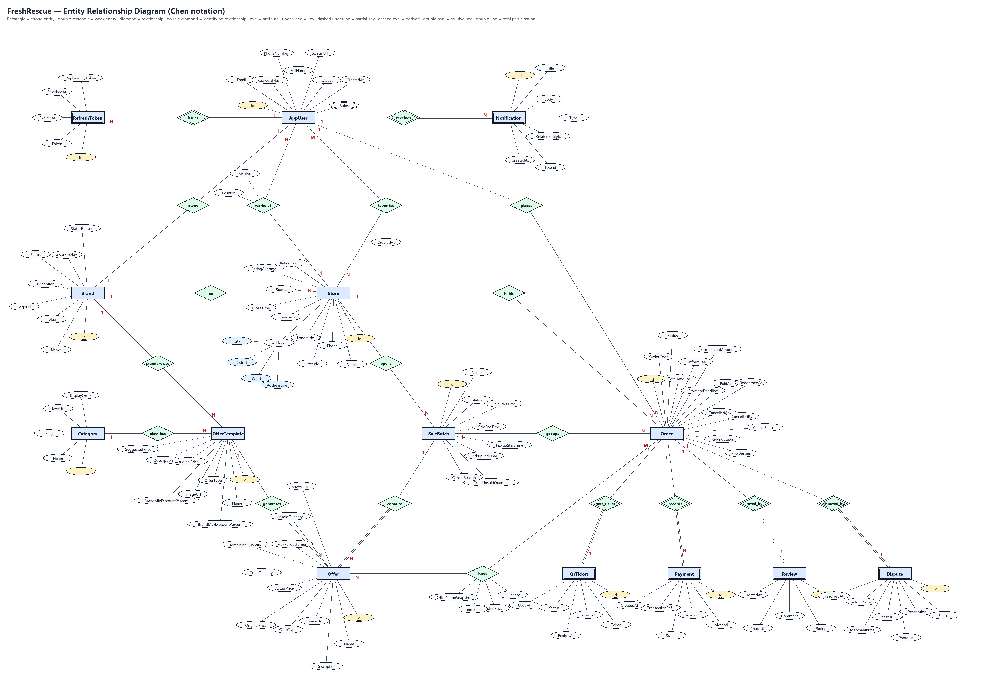

# FreshRescue — ERD (Chen notation) and mapping to the relational schema

> Nguyên liệu cho mục **1.2.1** và **1.2.2** của báo cáo (`08-REPORT-REQUIREMENTS.md` §2–§3), viết sẵn
> bằng tiếng Anh để Hiếu ghép thẳng vào Word. Ảnh: `FreshRescue-ERD-Chen.png` (chèn Word) /
> `.svg` (vector) / `.drawio` (mở trên app.diagrams.net để chỉnh tay). Thiết kế cột từng bảng:
> `table-design.md`. Mọi tên cột khớp với `02-DOMAIN-MODEL.md` §3 và Migration #1.

---

## 1. Entity Relationship Diagram



*Figure 1.2.1 — FreshRescue ERD in Chen notation. Rectangles are strong entities, double rectangles are
weak entities, diamonds are relationships (double diamonds are identifying relationships), ovals are
attributes. Underlined = key, dashed underline = partial key, dashed oval = derived attribute, double
oval = multivalued attribute, double line = total participation.*

### 1.1. Strong entities

| Entity | Meaning | Key | Notable attributes |
| --- | --- | --- | --- |
| `AppUser` | Any account: customer, store staff, brand manager, system admin | `Id` | `Email`, `PasswordHash`, `PhoneNumber`, `FullName`, `AvatarUrl`, `IsActive`, `CreatedAt`, **`Roles` (multivalued)** |
| `Brand` | A food-and-beverage chain, approved by an admin | `Id` (`Slug` is a candidate key) | `Name`, `Slug`, `LogoUrl`, `Description`, `Status`, `ApprovedAt`, `StatusReason` |
| `Store` | A branch of a brand where customers pick up | `Id` | `Name`, **`Address` (composite: `AddressLine`, `Ward`, `District`, `City`)**, `Latitude`, `Longitude`, `Phone`, `OpenTime`, `CloseTime`, `Status`, **`RatingAverage`, `RatingCount` (derived)** |
| `Category` | Food category used to classify templates | `Id` (`Slug` candidate key) | `Name`, `Slug`, `IconUrl`, `DisplayOrder` |
| `OfferTemplate` | A reusable item definition owned by a brand. Has **no quantity** | `Id` | `Name`, `Description`, `ImageUrl`, `OfferType`, `OriginalPrice`, `SuggestedPrice`, `BrandMinDiscountPercent`, `BrandMaxDiscountPercent` |
| `SaleBatch` | One end-of-day sale of one store | `Id` | `Name`, `Status`, `SaleStartTime`, `SaleEndTime`, `PickupStartTime`, `PickupEndTime`, `TotalUnsoldQuantity`, `CancelReason` |
| `Offer` | A template put into a batch with real quantity and final price. The thing customers buy | `Id` | `Name`, `Description`, `ImageUrl`, `OfferType`, `OriginalPrice`, `ActualPrice`, `TotalQuantity`, `RemainingQuantity`, `MaxPerCustomer`, `UnsoldQuantity`, `RowVersion` |
| `Order` | One customer, one store, one batch | `Id` (`OrderCode` candidate key) | `OrderCode`, `Status`, **`TotalAmount` (derived)**, `PlatformFee`, `StorePayoutAmount`, `PaymentDeadline`, `PaidAt`, `RedeemedAt`, `CancelledAt`, `CancelledBy`, `CancelReason`, `RefundStatus`, `RowVersion` |

### 1.2. Weak entities

A weak entity cannot exist without its owner and is drawn with a double rectangle; its identifying
relationship is a double diamond and its participation is total (double line).

| Weak entity | Owner | Partial key | Attributes |
| --- | --- | --- | --- |
| `RefreshToken` | `AppUser` | `Id` | `Token`, `ExpiresAt`, `RevokedAt`, `ReplacedByToken` |
| `Notification` | `AppUser` | `Id` | `Title`, `Body`, `Type`, `RelatedEntityId`, `IsRead`, `CreatedAt` |
| `QrTicket` | `Order` | `Id` | `Token`, `IssuedAt`, `ExpiresAt`, `Status`, `UsedAt` |
| `Payment` | `Order` | `Id` | `Method`, `Amount`, `Status`, `TransactionRef`, `CreatedAt` |
| `Review` | `Order` | `Id` | `Rating`, `Comment`, `PhotoUrl`, `CreatedAt` |
| `Dispute` | `Order` | `Id` | `Reason`, `Description`, `PhotoUrl`, `Status`, `MerchantNote`, `AdminNote`, `ResolvedAt` |

In the physical database every weak entity still gets its own surrogate `Guid` primary key (an EF Core
convention that keeps every table addressable by a single column). Semantically they remain weak:
a ticket, a payment, a review or a dispute is meaningless without the order it belongs to, and the
owner's key is a mandatory foreign key in each of them.

### 1.3. Attribute types present in the model

| Attribute type | Example in FreshRescue | How it is stored |
| --- | --- | --- |
| Key | `Id` of every entity; `Brand.Slug`, `Category.Slug`, `Order.OrderCode`, `RefreshToken.Token` are candidate keys | Primary key + `UNIQUE` index on each candidate key |
| Composite | `Store.Address` = `AddressLine` + `Ward` + `District` + `City` | Four separate columns, no `Address` column |
| Multivalued | `AppUser.Roles` — one account can hold several roles | Separate table `AspNetUserRoles(UserId, RoleId)` |
| Derived | `Store.RatingAverage`, `Store.RatingCount` (from `Review`); `Order.TotalAmount` (from `OrderItem`) | Stored anyway for read performance; kept consistent by the service layer (see `02-DOMAIN-MODEL.md` §7) |

### 1.4. Relationships

| # | Relationship | Entities | Cardinality | Participation / attributes |
| --- | --- | --- | --- | --- |
| 1 | `issues` | `AppUser` – `RefreshToken` | 1 : N | identifying; `RefreshToken` total |
| 2 | `receives` | `AppUser` – `Notification` | 1 : N | identifying; `Notification` total |
| 3 | `owns` | `AppUser` – `Brand` | 1 : 1 | a brand has exactly one manager account |
| 4 | `works_at` | `Store` – `AppUser` | 1 : N | attributes `Position`, `IsActive`; one staff belongs to one store |
| 5 | `favorites` | `AppUser` – `Store` | M : N | attribute `CreatedAt` |
| 6 | `places` | `AppUser` – `Order` | 1 : N | |
| 7 | `has` | `Brand` – `Store` | 1 : N | |
| 8 | `standardizes` | `Brand` – `OfferTemplate` | 1 : N | |
| 9 | `classifies` | `Category` – `OfferTemplate` | 1 : N | |
| 10 | `opens` | `Store` – `SaleBatch` | 1 : N | |
| 11 | `fulfils` | `Store` – `Order` | 1 : N | denormalised copy of the batch's store (`02` §7) |
| 12 | `generates` | `OfferTemplate` – `Offer` | 1 : N | |
| 13 | `contains` | `SaleBatch` – `Offer` | 1 : N | `Offer` total |
| 14 | `groups` | `SaleBatch` – `Order` | 1 : N | |
| 15 | `buys` | `Order` – `Offer` | M : N | attributes `Quantity`, `UnitPrice`, `LineTotal`, `OfferNameSnapshot` |
| 16 | `gets_ticket` | `Order` – `QrTicket` | 1 : 1 | identifying; `QrTicket` total |
| 17 | `records` | `Order` – `Payment` | 1 : N | identifying |
| 18 | `rated_by` | `Order` – `Review` | 1 : 1 | identifying |
| 19 | `disputed_by` | `Order` – `Dispute` | 1 : 1 | identifying |

Secondary references that are foreign keys in the schema but were left off the drawing to keep it
readable: `Brand.ApprovedByUserId`, `SaleBatch.CreatedByUserId`, `QrTicket.UsedByStaffUserId`,
`Dispute.ResolvedByUserId`, `Review.CustomerUserId`, `Dispute.CustomerUserId` (all → `AppUser`),
`Review.StoreId` (→ `Store`) and `Offer.CategoryId` (→ `Category`, a snapshot copied from the template).

---

## 2. Mapping the ERD to the relational schema

The seven-step algorithm from the lecture (Slot 6) is applied in order. The result is the 17 tables
created by Migration #1; column details are in `table-design.md`.

### Step 1 — Regular (strong) entity types

Each strong entity becomes a table whose columns are its simple attributes; the key becomes the primary
key. Composite attributes are flattened into their components; multivalued attributes are deferred to
step 6.

| Entity | Table | Primary key | Notes |
| --- | --- | --- | --- |
| `AppUser` | `AspNetUsers` | `Id` | table name fixed by ASP.NET Core Identity |
| `Brand` | `Brands` | `Id` | `Slug` `UNIQUE` |
| `Store` | `Stores` | `Id` | `Address` flattened into `AddressLine`, `Ward`, `District`, `City`; derived `RatingAverage`, `RatingCount` stored |
| `Category` | `Categories` | `Id` | `Slug` `UNIQUE` |
| `OfferTemplate` | `OfferTemplates` | `Id` | |
| `SaleBatch` | `SaleBatches` | `Id` | `CHECK` on the four time columns (`BR-15`) |
| `Offer` | `Offers` | `Id` | `CHECK (RemainingQuantity >= 0)`, `RowVersion` for optimistic concurrency |
| `Order` | `Orders` | `Id` | `OrderCode` `UNIQUE`; derived `TotalAmount` stored |

### Step 2 — Weak entity types

Each weak entity becomes a table that includes the owner's primary key as a foreign key. The textbook
key would be (owner key + partial key); the project uses a surrogate `Id` as primary key and keeps the
owner key as a mandatory, indexed foreign key.

| Weak entity | Table | Owner FK | Extra constraint |
| --- | --- | --- | --- |
| `RefreshToken` | `RefreshTokens` | `UserId` → `AspNetUsers` | `Token` `UNIQUE` |
| `Notification` | `Notifications` | `UserId` → `AspNetUsers` | |
| `QrTicket` | `QrTickets` | `OrderId` → `Orders` | `OrderId` `UNIQUE` (1 : 1, see step 3) |
| `Payment` | `Payments` | `OrderId` → `Orders` | |
| `Review` | `Reviews` | `OrderId` → `Orders` | `OrderId` `UNIQUE` (1 : 1) |
| `Dispute` | `Disputes` | `OrderId` → `Orders` | `OrderId` `UNIQUE` (1 : 1) |

### Step 3 — Binary 1 : 1 relationships

The foreign key goes on the side with total participation and is made `UNIQUE`.

| Relationship | Foreign key placed in | Constraint |
| --- | --- | --- |
| `owns` | `Brands.OwnerUserId` → `AspNetUsers` | `UNIQUE` — one account manages at most one brand |
| `gets_ticket` | `QrTickets.OrderId` → `Orders` | `UNIQUE` |
| `rated_by` | `Reviews.OrderId` → `Orders` | `UNIQUE` — one review per order (`BR-12`) |
| `disputed_by` | `Disputes.OrderId` → `Orders` | `UNIQUE` — one dispute per order (`BR-17`) |

### Step 4 — Binary 1 : N relationships

The primary key of the "1" side becomes a foreign key in the table of the "N" side. No new table is
created, except when the relationship carries attributes of its own.

| Relationship | Foreign key |
| --- | --- |
| `issues` | `RefreshTokens.UserId` |
| `receives` | `Notifications.UserId` |
| `places` | `Orders.CustomerUserId` |
| `has` | `Stores.BrandId` |
| `standardizes` | `OfferTemplates.BrandId` |
| `classifies` | `OfferTemplates.CategoryId` |
| `opens` | `SaleBatches.StoreId` |
| `fulfils` | `Orders.StoreId` |
| `generates` | `Offers.OfferTemplateId` |
| `contains` | `Offers.SaleBatchId` |
| `groups` | `Orders.SaleBatchId` |
| `records` | `Payments.OrderId` |
| `works_at` | **new table `StoreStaff`** (`Id`, `UserId` → `AspNetUsers` `UNIQUE`, `StoreId` → `Stores`, `Position`, `IsActive`) — a separate table is used because the relationship has attributes and because not every user works at a store, so adding nullable columns to `AspNetUsers` would be wrong. `UserId` is `UNIQUE` to enforce "one staff, one store" |

### Step 5 — Binary M : N relationships

Each M : N relationship becomes a new table whose primary key is the pair of foreign keys; relationship
attributes become columns of that table.

| Relationship | Table | Primary key | Columns |
| --- | --- | --- | --- |
| `buys` | `OrderItems` | surrogate `Id` (`OrderId` and `OfferId` each carry a foreign-key index) | `OrderId` → `Orders`, `OfferId` → `Offers`, `Quantity`, `UnitPrice`, `LineTotal`, `OfferNameSnapshot` — like `WORKS_ON(Hours)` in the lecture example |
| `favorites` | `FavoriteStores` | composite (`CustomerUserId`, `StoreId`) | `CustomerUserId` → `AspNetUsers`, `StoreId` → `Stores`, `CreatedAt` |

### Step 6 — Multivalued attributes

`AppUser.Roles` becomes the table `AspNetUserRoles(UserId, RoleId)` with a composite primary key, where
`RoleId` references the lookup table `AspNetRoles` holding the four fixed roles `SystemAdmin`,
`BrandManager`, `StoreStaff`, `Customer`.

### Step 7 — N-ary relationships

None. Every relationship in the model is binary.

### Resulting schema

```
AspNetUsers     (Id, UserName, Email, PasswordHash, PhoneNumber, FullName, AvatarUrl, IsActive, CreatedAt, …)
RefreshTokens   (Id, UserId→AspNetUsers, Token, ExpiresAt, RevokedAt, ReplacedByToken)
Brands          (Id, Name, Slug, LogoUrl, Description, OwnerUserId→AspNetUsers, Status, ApprovedAt, ApprovedByUserId→AspNetUsers, StatusReason, …)
Stores          (Id, BrandId→Brands, Name, AddressLine, Ward, District, City, Latitude, Longitude, Phone, OpenTime, CloseTime, Status, RatingAverage, RatingCount, …)
StoreStaff      (Id, UserId→AspNetUsers, StoreId→Stores, Position, IsActive, …)
Categories      (Id, Name, Slug, IconUrl, DisplayOrder, …)
OfferTemplates  (Id, BrandId→Brands, CategoryId→Categories, Name, Description, ImageUrl, OfferType, OriginalPrice, SuggestedPrice, BrandMinDiscountPercent, BrandMaxDiscountPercent, …)
SaleBatches     (Id, StoreId→Stores, Name, Status, SaleStartTime, SaleEndTime, PickupStartTime, PickupEndTime, CreatedByUserId→AspNetUsers, ActivatedAt, ClosedAt, TotalUnsoldQuantity, CancelReason, …)
Offers          (Id, SaleBatchId→SaleBatches, OfferTemplateId→OfferTemplates, CategoryId→Categories, Name, Description, ImageUrl, OfferType, OriginalPrice, ActualPrice, TotalQuantity, RemainingQuantity, MaxPerCustomer, UnsoldQuantity, RowVersion, …)
Orders          (Id, OrderCode, CustomerUserId→AspNetUsers, StoreId→Stores, SaleBatchId→SaleBatches, Status, CancelledBy, CancelReason, RefundStatus, TotalAmount, PlatformFee, StorePayoutAmount, PaymentDeadline, PaidAt, RedeemedAt, CancelledAt, RowVersion, …)
OrderItems      (Id, OrderId→Orders, OfferId→Offers, Quantity, UnitPrice, LineTotal, OfferNameSnapshot)
QrTickets       (Id, OrderId→Orders, Token, IssuedAt, ExpiresAt, Status, UsedAt, UsedByStaffUserId→AspNetUsers)
Payments        (Id, OrderId→Orders, Method, Amount, Status, TransactionRef, CreatedAt)
Reviews         (Id, OrderId→Orders, CustomerUserId→AspNetUsers, StoreId→Stores, Rating, Comment, PhotoUrl, CreatedAt)
Disputes        (Id, OrderId→Orders, CustomerUserId→AspNetUsers, Reason, Description, PhotoUrl, Status, MerchantNote, AdminNote, ResolvedByUserId→AspNetUsers, ResolvedAt, …)
FavoriteStores  (CustomerUserId→AspNetUsers, StoreId→Stores, CreatedAt)
Notifications   (Id, UserId→AspNetUsers, Title, Body, Type, RelatedEntityId, IsRead, CreatedAt)
```

`…` stands for the audit / soft-delete columns `CreatedAt`, `UpdatedAt`, `IsDeleted`, `DeletedAt` where the
entity implements `IAuditable` / `ISoftDelete` (`02-DOMAIN-MODEL.md` §1.1). Primary keys are underlined
in the report; here they are the first column of each line (the pair for `FavoriteStores`).
